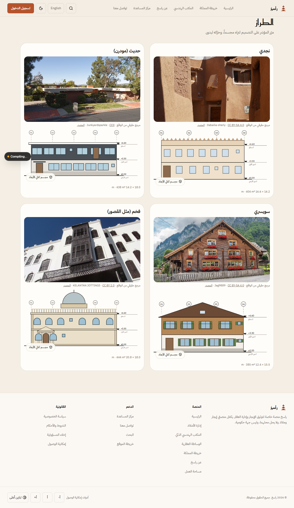
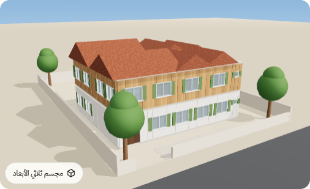
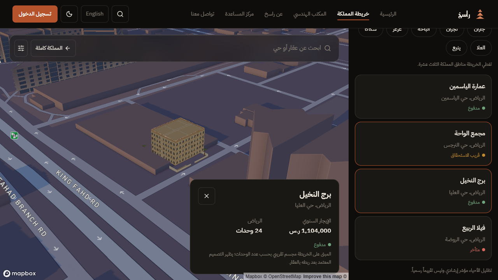

<div align="center">

<h1>Rasikh · راسخ</h1>

**Your property, on solid ground.** · **عقارك على أرض ثابتة**

An Arabic-first platform for the Saudi property market, in three separate sections:<br />
**property management** · an **AI engineering office** · **real estate brokerage**.

[](https://github.com/FaisalAlghates/rasikh/actions/workflows/ci.yml)


**[Live demo · عرض مباشر](https://faisalalghates.github.io/rasikh/ar/)** (a free static copy: sign-in and saving are off) · [العربية](#نبذة-بالعربي) · [Sections](#the-three-sections) · [Engineering office](#the-ai-engineering-office) · [Map](#the-kingdom-map) · [Run it](#getting-started) · [Tests](#testing) · [Roadmap](#status-and-roadmap)

</div>

> **Rasikh complements Ejar and Mullak. It does not replace them.** It never replaces an Ejar contract, the Ejar deposit or the official handover form; it does not process, lend or finance rent; it runs no public listings marketplace; and it never stamps drawings or files permits in an engineer's name. Rasikh is a private platform, not a government entity.



## Contents

1. [The three sections](#the-three-sections)
2. [The AI engineering office](#the-ai-engineering-office)
3. [The Kingdom map](#the-kingdom-map)
4. [Architecture](#architecture)
5. [Getting started](#getting-started)
6. [Testing](#testing)
7. [Security and privacy](#security-and-privacy)
8. [Status and roadmap](#status-and-roadmap)
9. [Documentation](#documentation)

## The three sections

After the landing page a visitor picks **one** section. Each has its own page with a walkthrough video, its own subscription (**all free at launch**, see `LAUNCH_FREE` in `packages/shared`) and its own workspace and data: nothing from one section appears in another.

| Section                   | For                                | What it gives                                                                                                                                                                  |
| ------------------------- | ---------------------------------- | ------------------------------------------------------------------------------------------------------------------------------------------------------------------------------ |
| **Property management**   | Owners, managers, tenants, vendors | Portfolio on a 3D Kingdom map, leases and payment ledger, guided inspections, Property Health Record, maintenance, buildings and owners associations, a real-estate assistant. |
| **AI engineering office** | Licensed engineering offices       | A private design copilot: brief to code-checked designs, a full permit-style drawing set, a bill of quantities, a discipline workflow with engineer approval.                  |
| **Real estate brokerage** | REGA-licensed brokers              | FAL licence reminders, leads with a forward-only funnel, viewings, brokerage contracts, an immutable server-timestamped log, and an ad compliance checker.                     |

Eleven short videos, one per section and per feature, are in `apps/web/public/videos` and on the section pages (`/ar/sections/property`, `/office`, `/broker`).

### Property management in detail

| Module                     | What you get                                                                                                                                                         |
| -------------------------- | -------------------------------------------------------------------------------------------------------------------------------------------------------------------- |
| **Portfolio and 3D map**   | The whole Kingdom on Mapbox 3D, with each property standing on its pin as a building (see [the map](#the-kingdom-map)).                                              |
| **Leases and payments**    | Lease records that reference the Ejar contract number, a payment schedule, the Riyadh rent-freeze helper, free in-app and calendar reminders, receipt uploads.       |
| **Guided inspections**     | Room by room at move-in and move-out with in-app camera evidence (capture time, SHA-256, GPS), two-party sign-off with fresh re-authentication, a comparison report. |
| **Property Health Record** | A timeline of every event on the property, including approved designs handed off from an engineering office.                                                         |
| **Maintenance**            | Tickets with photos, urgency and an SLA timer, suggested responsibility (a suggestion, not a ruling), vendors with their own login.                                  |
| **Buildings and owners**   | Shared expenses that each need a receipt, balances visible to every owner, quote comparison, one ballot per unit. Complements Mullak.                                |
| **Assistant**              | Answers about your own records and the product's guidance, marked as AI output and restricted to real estate.                                                        |
| **Privacy rights (PDPL)**  | Export my data and delete my account; Arabic and English privacy policy, terms and disclaimers (drafts pending legal review).                                        |

## The AI engineering office

A 24/7 design copilot **for** licensed offices, not a replacement for them. The model never draws and never decides compliance: a deterministic, versioned engine does, and a verified engineer approves.

```
client brief (plot, area, programme, style, in the client's own words)
  → programme read back for confirmation
  → Ministry of Municipalities and Housing requirements applied to the plot
  → 6–12 genuinely different options, each passing every zoning and code check
  → bill of quantities per option · client picks · office develops
  → engineers approve their own discipline · the lead releases
  → released set handed off to the Property Health Record
```

### Four design languages

| Najdi                                         | Modern                                       | Swiss                                            | Palace                                      |
| --------------------------------------------- | -------------------------------------------- | ------------------------------------------------ | ------------------------------------------- |
| Courtyard house, crenellation, small openings | Clad upper volume, framed glazing, thin slab | Compact block, pitched roof, timber and shutters | Symmetry, columned portico, arches and dome |

Each language ranks the layouts that suit it, changes the façade, windows and 3D model, and always fits the plot. Every style card shows a **real, credited photograph** as a reference (see [docs/CREDITS.md](docs/CREDITS.md)); hover a design to see it as a lit 3D model that turns with the pointer. The brief reader picks the style from the client's own words.



### A consultant-style permit set

Framed A3 sheets coded by discipline (`AR`, `ST`, `EL`, `ME`, `FS`) with an Arabic and English title block, a stamp area left for the office, axis bubbles and level marks:

- **Architectural**: site, plans per floor, elevations, sections, levels, thermal insulation with U-values, accessibility, door and window schedules, areas.
- **Structural**: general notes, axes and columns, slab and beam layout, column schedule, a preliminary calculation summary.
- **Electrical, mechanical and plumbing, fire and safety**: a plan per floor with symbol legends and counts.

Prints to A3 landscape, one sheet per page; exports DXF, IFC and glTF. A printable sample draft set: [docs/samples/drawing-set-draft-sample.pdf](docs/samples/drawing-set-draft-sample.pdf).

### Honest limits

- Saudi Building Code checks come **only** from the rule engine. A rule that no office engineer has verified stays "not checked"; the model only explains results.
- No live Balady or Amanah interface exists. Heights from a plot's local plan are confirmed by the office. The Ministry's national requirements are built in with their clauses and should be verified against the official PDF before real permits.
- Every output is a **draft** until a licensed engineer of the right discipline approves it. Rasikh never stamps and never files a permit.
- Designs from other offices enter the shared library only with each office's and client's consent, and are credited. Design knowledge (climate, privacy, styles) is written in the product's knowledge base with its basis; nothing is scraped.

Full spec and implementation status: [docs/ENGINEERING_OFFICE.md](docs/ENGINEERING_OFFICE.md).

## The Kingdom map

The whole Kingdom on Mapbox Standard (a globe that lands on Saudi Arabia, lighting on Riyadh's clock), a pin per city, and the real buildings of the cities from OpenStreetMap. A property stands on its pin as a textured three.js building at true scale: its **released design** when one is handed off to it, otherwise a plausible villa or apartment block from its unit count. The card says which. Owners place the exact pin from the phone while at the property.



An optional **real view from Google** (photorealistic 3D imagery of the location) turns on with a Google Maps key; it is billed by Google per use and off by default. Without a Mapbox token or WebGL the map falls back to a flat schematic with the same interactions.

## Architecture

```
apps/web               Next.js 16 (App Router, TypeScript strict), Tailwind 4, Radix, next-intl (ar default, en), three.js
apps/mobile            Flutter 3.47, Riverpod, go_router, FlutterFire, ARB localization (ar default)
firebase/functions     Cloud Functions 2nd gen (TypeScript) in me-central2, Genkit for every AI flow
firebase               Firestore and Storage rules, indexes, emulator suite
packages/shared        Domain logic, the engineering engine, zod schemas and enums shared by web and functions
packages/design-tokens One tokens file: CSS variables and Flutter theme ("Najd Dusk")
docs                   Setup guides, design notes, the engineering-office spec, samples and screenshots
```

**Principles**

- **One source of truth for rules.** Schedules, SLA, balances, ad checks, inspection digests and the whole engineering engine live in `packages/shared`; the domain parts are ported to Dart with identical fixtures, so web, app and server agree.
- **Deny by default.** Firestore and Storage rules check organization membership and role on every access, with emulator tests per role. Roles live in custom claims set only by Functions.
- **Evidence you can trust.** Inspection media is hashed at capture, queued offline with retry, write-once after sign-off, and re-checked on the server before sealing.
- **Data stays in the Kingdom.** All user data in `me-central2` (Dammam). No model keys in clients; AI runs only in Functions.
- **AI is bounded.** A scope classifier refuses anything outside real estate; no legal rulings, valuations or financial advice; output is marked and never changes a record without a tap.
- **Arabic first.** RTL with logical CSS, mirrored icons, Hijri and Gregorian dates, SAR formatting, AA contrast checked in the tokens, reduced motion honoured.
- **Quiet luxury design.** One brand colour (Najdi clay), editorial type, almost no shadows, one glass layer per screen; WCAG 2.2 AA checked with axe in the end-to-end suite.

## Getting started

Prerequisites: Node 22, pnpm, Java (for the emulators), Firebase CLI, and Flutter 3.47 (for the app only).

```bash
pnpm install
pnpm --filter @rasikh/shared build        # shared is consumed from dist/
pnpm --filter @rasikh/functions build     # Functions bundle (lib/index.js)
pnpm emulators                            # Auth, Firestore, Storage, Functions on demo-rasikh
pnpm --filter @rasikh/web dev             # http://localhost:3000/ar
```

```bash
cd apps/mobile && flutter run             # uses the emulators in debug builds
```

Local development runs against the **demo project** `demo-rasikh`, so no cloud setup is needed. Copy `apps/web/.env.example` to `apps/web/.env.local` and add your own keys; never commit keys.

| Variable                      | Needed for                                                                                        |
| ----------------------------- | ------------------------------------------------------------------------------------------------- |
| `NEXT_PUBLIC_MAPBOX_TOKEN`    | The 3D Kingdom map (without it a flat schematic is shown).                                        |
| `NEXT_PUBLIC_GOOGLE_MAPS_KEY` | Optional "real view": Google's photorealistic 3D imagery of a location. Billed by Google per use. |
| `NEXT_PUBLIC_SITE_URL`        | Canonical links, sitemap and social cards, once the domain is registered.                         |

Steps for a real Firebase project are in [docs/FIREBASE-SETUP.md](docs/FIREBASE-SETUP.md) (Arabic).

<details>
<summary>Windows notes</summary>

- Java-based emulators need an ASCII project path; use a junction such as `C:\dev\rasikh`.
- `@swc/core` needs `SWC_NATIVE_BINDING_CACHE` pointing to a directory only your user can write to.
- Start the emulators with `FUNCTIONS_DISCOVERY_TIMEOUT=90` (a cold load of the Functions bundle can exceed the default).
- The Android emulator reaches the host at `10.0.2.2`; debug builds allow cleartext to it.

</details>

## Testing

```bash
pnpm test                                  # unit, security-rules and integration tests
pnpm --filter @rasikh/web e2e              # Playwright (needs the emulators and the dev server)
cd apps/mobile && flutter test             # widget and domain tests
pnpm lint && pnpm typecheck                # ESLint and TypeScript
```

| Layer                   | Coverage                                                                                                                    |
| ----------------------- | --------------------------------------------------------------------------------------------------------------------------- |
| `packages/shared`       | Domain, inspections, maintenance, buildings, broker, and the engineering engine (rules, options, styles, sheets, knowledge) |
| `firebase/functions`    | Functions, Firestore and Storage rules per role, the AI guard and a 46-prompt evaluation                                    |
| `apps/web` (Playwright) | End-to-end flows for each section in Arabic, accessibility with axe, legal pages and PDPL rights                            |
| `apps/mobile` (Flutter) | Domain ports with shared fixtures, and widget flows with in-memory fakes                                                    |

Two checks run only on request: the real Mapbox map (`RK_REAL_MAP=1 pnpm --filter @rasikh/web e2e map-real`, needs the network and a token) and the video recorder. CI runs lint, typecheck, test and build on every pull request.

**Walkthrough videos.** `pnpm --filter @rasikh/web videos` records every section and feature video from the real app (emulators and demo data) with Arabic captions burned in, into `apps/web/public/videos`. Re-record after a UI change.

## Security and privacy

- Firebase Auth with phone OTP (+966) and email; sensitive actions need a fresh sign-in.
- Create-only, append-only ledgers for building expenses, contributions, ballots and the broker activity log.
- Engineering offices act only after the Rasikh team verifies the commercial register, engineering-authority classification and Balady activation; engineers approve only their own discipline, and access pauses when their membership ends.
- App Check on web and mobile; secrets only in `.env` (gitignored) or Secret Manager.
- AI: metadata-only logs, a per-person daily limit and a monthly organization cap, jailbreak and off-topic refusal before any model call.
- Saudi PDPL: explicit consent, purpose-limited data, export and delete my data.

Found a security problem? Please report it privately to the maintainer instead of opening a public issue.

## Status and roadmap

Authoritative detail lives in [PLAN.md](PLAN.md) (phases and known gaps), [CLAUDE.md](CLAUDE.md) (product rules) and [REMAINING.md](REMAINING.md) (what needs the owner). Nothing is deployed to production yet.

| Phase | Scope                                                   | Status                                              |
| ----- | ------------------------------------------------------- | --------------------------------------------------- |
| 1–3   | Foundation, design system, 3D Kingdom map               | Done                                                |
| 4     | Leases and payment ledger                               | Done                                                |
| 5     | Guided inspections and Property Health Record           | Done                                                |
| 6     | Maintenance, buildings and associations                 | Done                                                |
| 7     | Broker CRM and ad checker                               | Done                                                |
| 8     | Real-estate AI                                          | Done on a cost-free local engine and knowledge base |
| 9     | AI engineering office                                   | Built on the free stack; paid inputs pending        |
| 10    | Sections, videos, polish, security, performance, launch | In progress                                         |

**Needs the owner before launch:** Firebase Blaze (deploying Functions and Storage, phone OTP, hosting), a real model key if a model is wanted (and an image model for photoreal renders of a design), the licensed Saudi Building Code text so an office engineer can verify the remaining rules, a domain, lawyer review of the legal pages (PDPL), and Apple and Google Play accounts. An engineer should also verify the transcribed Ministry values against the official PDF.

## Documentation

The full set is indexed in [docs/README.md](docs/README.md).

| Document                                                                                                                                   | What it covers                                                                           |
| ------------------------------------------------------------------------------------------------------------------------------------------ | ---------------------------------------------------------------------------------------- |
| [docs/DIAGRAMS.md](docs/DIAGRAMS.md)                                                                                                       | 39 diagrams (Mermaid, also SVG): use cases, C4, ERD, state machines, sequences, backend. |
| [docs/SRS.md](docs/SRS.md)                                                                                                                 | Software Requirements Specification (ISO/IEC/IEEE 29148): numbered, testable.            |
| [docs/ARCHITECTURE.md](docs/ARCHITECTURE.md)                                                                                               | C4 views, runtime flows, cross-cutting concerns and 11 decision records.                 |
| [docs/DATA-MODEL.md](docs/DATA-MODEL.md)                                                                                                   | Collections, storage layout, visibility and tested invariants.                           |
| [docs/API.md](docs/API.md)                                                                                                                 | Cloud Functions callables, error codes and the model-provider interface.                 |
| [docs/SECURITY.md](docs/SECURITY.md)                                                                                                       | Controls, STRIDE threat model, PDPL and open risks.                                      |
| [docs/TEST-PLAN.md](docs/TEST-PLAN.md)                                                                                                     | Strategy, how to run, coverage by requirement, exit criteria.                            |
| [docs/OPERATIONS.md](docs/OPERATIONS.md)                                                                                                   | Environments, deploying, monitoring, backup, cost and a runbook.                         |
| [docs/CONTRIBUTING.md](docs/CONTRIBUTING.md)                                                                                               | Working agreement, standards and the definition of done.                                 |
| [docs/USER-GUIDE.ar.md](docs/USER-GUIDE.ar.md)                                                                                             | دليل المستخدم لكل دور (بالعربية).                                                        |
| [docs/ENGINEERING_OFFICE.md](docs/ENGINEERING_OFFICE.md)                                                                                   | The engineering office: spec, roles, engine, limits.                                     |
| [CLAUDE.md](CLAUDE.md)                                                                                                                     | Product rules, stack, design system and AI rules (source of truth).                      |
| [PLAN.md](PLAN.md) · [CHANGELOG.md](CHANGELOG.md)                                                                                          | Phases and progress; what changed.                                                       |
| [REMAINING.md](REMAINING.md) · [REMAINING.ar.md](REMAINING.ar.md)                                                                          | What still needs the owner, in English and Arabic.                                       |
| [docs/FIREBASE-SETUP.md](docs/FIREBASE-SETUP.md) · [docs/STORE-READINESS.md](docs/STORE-READINESS.md) · [docs/CREDITS.md](docs/CREDITS.md) | Firebase setup (Arabic), store needs, credits.                                           |

## نبذة بالعربي

راسخ منصة عربية أولاً لسوق العقار السعودي، في ثلاثة أقسام منفصلة: **إدارة الأملاك** و**المكتب الهندسي الذكي** و**الوساطة العقارية**. لكل قسم صفحته واشتراكه ومساحة عمله، وكلها مجانية الآن.

- **إدارة الأملاك:** عقود ودفعات وفحص موثّق بالصور وصيانة وعمائر واتحادات ملاك، وسجل واحد للعقار، وخريطة ثلاثية الأبعاد للمملكة يقف فيها العقار بناءً على أرضه.
- **المكتب الهندسي الذكي:** من وصف العميل إلى تصاميم مختلفة مطابقة للكود واشتراطات الأمانة، بأربعة طُرز (نجدي وحديث وسويسري وفخم) بصور مرجعية حقيقية ومجسم ثلاثي الأبعاد عند المرور، مع مجموعة رسومات كاملة بترتيب المكاتب الاستشارية وجدول كميات. المطابقة تقررها قواعد محسوبة لا الذكاء الاصطناعي، وكل مخرج مسودة حتى يعتمده مهندس مرخّص.
- **الوساطة العقارية:** عملاء ومعاينات وسجل أنشطة موثّق لا يُعدَّل وفاحص للبيانات الإلزامية للإعلان.

راسخ **يكمّل** منصتي إيجار ومُلّاك ولا يغني عنهما، ولا يعالج دفعات الإيجار ولا يعرض إعلانات للعامة، ولا يختم ولا يقدّم طلبات الرخص باسم مهندس. بياناتك تُحفظ في الدمام، والذكاء الاصطناعي يعمل على الخادم فقط ومخرجاته اقتراحات تراجعها بنفسك.

## License

Proprietary. All rights reserved. © Rasikh.
